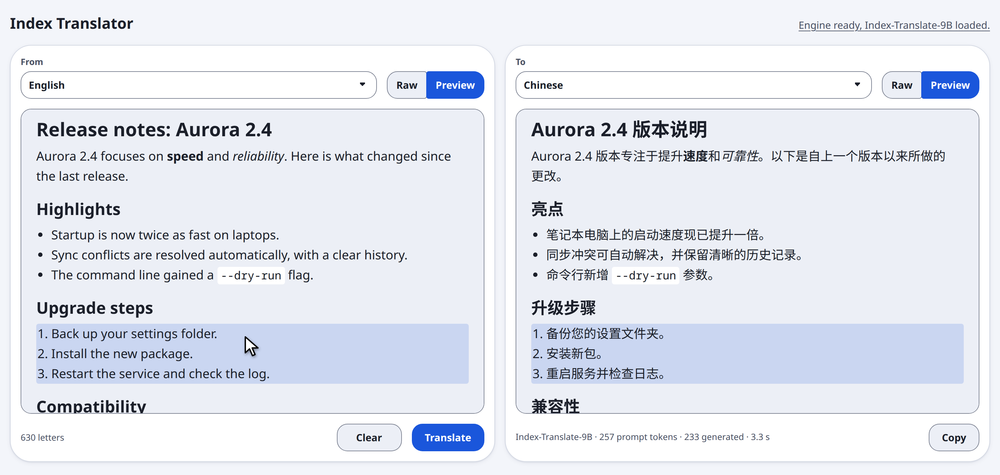

<p align="center">
  
</p>

<h1 align="center">Index Translator</h1>

<p align="center">
  <b>Translate whole documents, PDFs and pictures on your own GPU.<br>Nothing leaves your machine.</b>
</p>

<p align="center">
  <a href="https://github.com/ruihe774/index-translator/actions/workflows/ci.yml"></a>
  <a href="https://codecov.io/gh/ruihe774/index-translator"></a>
  <a href="LICENSE"></a>
  
  
  
</p>

<p align="center">
  <a href="#install">Install</a> ·
  <a href="#using-it">Using it</a> ·
  <a href="#use-it-from-other-programs">API</a> ·
  <a href="#settings">Settings</a> ·
  <a href="THIRD_PARTY_NOTICES.md">Licenses</a>
</p>

<p align="center">
  
  <br>
  <sub>One click on a PDF page thumbnail turns the page into Markdown, translated here from English to Chinese.
  Headings and tables survive and are shown formatted on both sides; the paragraph under the pointer is highlighted in both,
  and a click scrolls the other side to it. Page 110 of
  <a href="https://ntrs.nasa.gov/citations/20140003548">NASA/TM-2014-217388</a>, a US government work in the public domain.</sub>
</p>

---

## What it does

Index Translator is a local translator for people who cannot, or would rather not, paste their documents into an
online service. It runs the Index-Translate 9B models on your GPU, with no accounts, quotas or fees.

| | |
|---|---|
| 🔒 **Private and offline** | Models run on your GPU. Your text never leaves your machine, so confidential documents are fine. |
| 📄 **Built for whole documents** | A long-document model translates a full text in one pass (Chinese ↔ English, Chinese ↔ Japanese). The app picks it for you by length. |
| 📑 **Opens your files** | Text, Markdown, PDF and Word files are read in your browser; one click on a PDF page thumbnail turns it into Markdown. |
| 🖼️ **Reads pictures** | Drop a screenshot or photo (JPEG, PNG, WebP); the model reads and translates the text in it. No separate OCR step. |
| 🎞️ **Subtitles, and transcripts of recordings** | Translate `.srt` files cue by cue with their timing kept, or turn a recording or video into speaker-labelled subtitles first (preview). |
| 🌐 **Web pages** | Paste an address and the server fetches the page as Markdown (off until you allow some sites). |
| 🔊 **Reads aloud** | Hear the source or the translation, from any paragraph, in Chinese, English, Japanese, Spanish or Arabic, with voices and speed (IndexTTS-2.5, also local). |
| ✅ **Tells you what went missing** | Models can silently drop or repeat paragraphs. The app counts paragraphs, warns you and names the paragraphs that went missing, were merged or were repeated; click one side to jump to the matching paragraph on the other. |
| 📚 **Terminology and style** | Glossary, hard rules ("keep placeholders unchanged"), soft style guidance and a genre such as academic paper or subtitles. |
| ✍️ **Markdown stays Markdown** | Headings, lists, tables and code are shown formatted as they stream in, with Raw / Preview per side. Copy returns the Markdown, and the formatted text as rich text when the translation is shown formatted. |

Also: streaming with **Stop**, correct Chinese and Japanese typography, an interface checked against WCAG 2.2 AA
(keyboard and screen readers), and a [local REST API](#use-it-from-other-programs) so other programs can use the same
translator.

## Install

**You need** a GPU with a working Vulkan driver (tested on an AMD Radeon RX 9070, 16 GiB) and about 18 GiB of disk
for the models. Without a usable GPU, set `GPU_LAYERS=0` to run on the CPU, which is much slower. If something is
missing (no Vulkan driver, no models yet), the app says what and how to fix it, then stops.

Pick one:

| Your system | Use |
|---|---|
| Linux (x86-64 or aarch64) | [AppImage](#linux-appimage) |
| Windows 10 / 11 (64-bit) | [Installer](#windows-installer) |
| Anything else, or you want to hack on it | [Build from source](#build-from-source) |

### Linux AppImage

`Index_Translator-x86_64.AppImage` and `Index_Translator-aarch64.AppImage` are built for every
change: on GitHub, open **Actions**, the latest **CI** run, and download the one for your
processor under **Artifacts** (GitHub hands it out as a zip file; unpack it). The commands below
use the x86-64 name. Then:

```bash
chmod +x Index_Translator-x86_64.AppImage
./Index_Translator-x86_64.AppImage fetch   # once: the models and example voices, about 19.2 GiB
./Index_Translator-x86_64.AppImage         # start; the app opens in your browser
```

Stop the app with `Ctrl+C`. `./Index_Translator-x86_64.AppImage --help` lists the options.

- `fetch` puts the models into `~/.local/share/index-translator` and needs `curl`. An interrupted
  download continues when you run it again. To leave out reading aloud (3.7 GiB):
  `fetch --model index-translate-9b --model index-nailong-9b`. Before it downloads, `fetch` shows each
  model's license and waits for you to type `yes`; the speech model is under bilibili's own license
  with usage conditions, not Apache or MIT. `notices` prints the licenses of the software in the
  AppImage; they are also in [THIRD_PARTY_NOTICES.md](THIRD_PARTY_NOTICES.md).
- It runs on x86-64 or aarch64 Linux as new as Ubuntu 24.04 or newer (Debian 13, Fedora 40 and later). Besides
  the Vulkan driver it uses the system's `libgomp` (installed on most systems). Reading aloud needs
  an x86-64 processor with AVX2.
- **NVIDIA GPUs:** `Index_Translator-x86_64-cuda.AppImage` and `Index_Translator-aarch64-cuda.AppImage` (the
  same download, next to the others) run on CUDA 13 instead of Vulkan: use them with a driver of version 580 or
  newer (`nvidia-smi` shows it); no Vulkan driver is needed, and they work the same otherwise. They are larger,
  as they carry NVIDIA's CUDA runtime libraries. The other AppImages use Vulkan, which NVIDIA's driver also
  provides.

### Windows installer

`Index_Translator-Setup-x86_64.exe` is built for every change: on GitHub, open **Actions**, the
latest **CI** run, and download it under **Artifacts** (GitHub hands it out as a zip file; unpack
it). It needs 64-bit Windows 10 or 11. Then:

1. Run the installer. It installs for your user only (into `%LOCALAPPDATA%\Programs\Index Translator`
   unless you choose another folder) and needs no administrator rights. The installer is not
   signed, so Windows SmartScreen may warn you: choose **More info**, then **Run anyway**.
2. Start **Index Translator** from the Start menu (or let the installer start it). A small window
   with four links opens.
3. Once, click **Download models**: it fetches the models and example voices (about 19.2 GiB) in a
   console window, shows each model's license and waits for you to type `yes`. **Do not close the
   console window until it says it is done**: closing it stops the download (running it again
   continues where it stopped).
4. Click **Start translator**. The app opens in your browser; the port (3000) can be changed in the
   window first. **Do not close the console window that opens: the app runs in it, and closing it
   stops the app** (the page in your browser then stops working). Leave it open, or minimize it,
   for as long as you use the translator. To stop the app, press `Ctrl+C` in that window or close it.

**Third-party notices** shows the licenses of the bundled software (also in
[THIRD_PARTY_NOTICES.md](THIRD_PARTY_NOTICES.md)); **Server settings** lists every option. For options
the window does not offer, open Command Prompt in the install folder and start the server there,
for example `bun src\server.ts --port 8080`.

The models are downloaded into the `models` folder and the voices into the `voices` folder inside
the install folder. Uninstalling (Windows **Settings**, **Apps**) leaves them in place, so delete
the folder by hand if you want the space back. Downloading needs `curl`, which Windows 10 and later
include. Reading aloud needs a processor with AVX2.

### Build from source

```bash
bun src/server.ts
```

Then open **http://127.0.0.1:3000/** in your browser. Stop the app with `Ctrl+C`.

Before the first start, build the engines and get the models once (about 19.2 GiB):

```bash
bun scripts/build_llama.ts      # translation engine (llama.cpp, Vulkan): built from source, 1 to 2 minutes
bun scripts/build_audiocpp.ts   # speech engine (audio.cpp, Vulkan): built from source, 1 to 2 minutes
bun scripts/build_soxr.ts       # libsoxr, the resampler the speech engine uses: built from source, seconds
bun scripts/build_libopus.ts    # libopus, which compresses speech for the browser and reads compressed uploads: built from source, seconds
bun scripts/fetch_models.ts     # the two translation models, the speech and voice separation models, the sentence segmentation and alignment models, example voices
bun scripts/fetch_onnxruntime.ts  # ONNX Runtime, which runs the sentence segmentation and alignment models, into vendor/
bun scripts/fetch_web_libs.ts   # the libraries that open PDF and Word files and show equations in the browser, into public/vendor/
bun scripts/fetch_turndown.ts   # turndown, which turns a fetched web page into Markdown, into vendor/
```

Opening PDF and Word files is optional too: without `fetch_web_libs.ts` the app runs, opens text and
Markdown files, says that PDF and Word support is not installed, and shows equations as their TeX. Without `build_libopus.ts` reading
aloud sends its audio as WAV, which is much larger, and voice samples are uploaded as WAV too. Translating a web page by its address needs `fetch_turndown.ts`
and is off until you allow some sites (see [Translate a web page](#translate-a-web-page)).

Reading aloud is optional. To leave it out, skip `build_audiocpp.ts`, `build_soxr.ts` and `build_libopus.ts` and download only the
translation models with `bun scripts/fetch_models.ts --model index-translate-9b --model index-nailong-9b`.

You need [Bun](https://bun.sh) and `curl`, and to build the engines git, CMake, a C and C++
compiler, `glslc` and the Vulkan headers. On Debian and Ubuntu:
`sudo apt install build-essential git cmake ninja-build glslc libvulkan-dev spirv-headers`.
Both engines then need an x86-64 processor with AVX2 (Haswell, 2013, or newer) or an aarch64 one with
Armv8.2-A dot product and fp16 (Cortex-A76 and Apple M1 or newer).

On Windows the same three commands work in Command Prompt or PowerShell. Instead of the packages
above you need Git, CMake and Ninja (on the `PATH`), Visual Studio 2022 or later, or its Build Tools, with the
"Desktop development with C++" workload, and the [Vulkan SDK](https://vulkan.lunarg.com/sdk/home) (for
`glslc`); `curl` comes with Windows. Open a new terminal after installing them, so it sees the new
`PATH`. More in [WINDOWS.md](WINDOWS.md).

`bun scripts/build_appimage.ts` packs what you have built and fetched (the models excepted) into an AppImage of your own, and on
Windows `bun scripts/build_installer.ts` into an installer (it downloads Inno Setup if it is not
installed), both in `dist/`.

**CUDA instead of Vulkan (Linux, NVIDIA).** An engine has one GPU backend, never both. For CUDA 13, install the toolkit
(`nvcc`, cudart, cuBLAS and cuFFT headers and libraries; `CUDA_PATH` names it if it is not in `/usr/local/cuda-13`; `glslc` and
the Vulkan headers are not needed) and build the engines into their own directories, next to the Vulkan ones:

```bash
bun scripts/build_llama.ts --cuda      # vendor/llama.cpp-cuda
bun scripts/build_audiocpp.ts --cuda   # vendor/audio.cpp-cuda
LLAMA_DIR=vendor/llama.cpp-cuda AUDIO_DIR=vendor/audio.cpp-cuda SPEECH_BACKEND=cuda bun src/server.ts
bun scripts/build_appimage.ts --cuda   # dist/Index_Translator-<arch>-cuda.AppImage
```

By default the kernels are compiled so that the NVIDIA driver finishes them for your GPU on the first run (a short
wait, kept in the driver's cache afterwards), which is a little slower than a native build. `--cuda-arch=LIST`
names the architectures instead (`native` builds for the GPU in this machine only: fastest to build and to run, not
for sharing).

> [!NOTE]
> Reading aloud is optional. Skipping it saves 14.2 GiB of downloads and about 5.7 GiB of VRAM.


## Using it

Open the app in your browser (the AppImage and installer do it for you; from source it is
http://127.0.0.1:3000/). Pick languages, paste text, click **Translate**. Each section below covers one thing you can do:

- [Translate text](#translate-text) · [Open a file](#open-a-file) · [Translate an image](#translate-an-image) ·
  [Translate subtitles](#translate-subtitles) · [Translate a web page](#translate-a-web-page) ·
  [Transcribe a recording](#transcribe-a-recording-preview)
- [Read it aloud](#read-it-aloud) · [Check a translation](#check-a-translation)
- [Choose a model](#choose-a-model) · [Glossary and constraints](#glossary-and-constraints) · [History](#history)

### Translate text

1. Choose the **From** and **To** languages. Pick **Detect** if you are not sure of the
   source. Languages include English, Chinese, Japanese, Korean, German, French, Spanish, Russian
   and about 25 more.
2. Paste or type your text into the box, or click **Open** to take it from a file (see
   [Open a file](#open-a-file)).
3. Click **Translate**. The translation appears as it is generated. Click **Stop** to end it early,
   and **Copy translation** to copy the result. **Clear** empties both sides for a new text.

Translation starts only when you click **Translate**; it does not run while you type.

On a phone or another narrow screen, your text and the translation sit side by side, one to a screen:
swipe sideways, or tap **Source text** or **Translation** under them, to go from one to the other. Clicking
**Translate** brings the translation in. When the paragraphs are matched (see
[Check a translation](#check-a-translation)), the side you go to opens at the paragraph you were reading.

If the text you enter is written in Markdown (headings, lists, code blocks, tables, links and so
on), the translation is shown formatted, as it arrives, and after you click **Translate** your text
is shown formatted too. Each side has **Raw** and **Preview** buttons to switch between the
Markdown source and the formatted view; **Raw** on your side brings back the text box for editing.
The **Full view** button (the diagonal arrows, next to Read aloud) shows a side's formatted text alone
on the page, in a reading column that scrolls with the page. **Source text** and **Translation** stay
at the top, on any screen, to go from one to the other at the matching paragraph. Leave with the
button beside them, Escape, or the browser's Back. Reading aloud stops when you open it.
**Copy translation** copies the Markdown source as plain text and, when the translation is shown
formatted, also puts the formatted text on the clipboard as rich text. Links open in a new tab;
images are shown as links and are not loaded.

Equations written in TeX between dollar signs are shown typeset: `$E = mc^2$` within a line, and
`$$ … $$` set apart, on one line or with each `$$` on a line of its own. A dollar sign followed by a
space or a closing one followed by a digit is not an equation, so `$5 and $10` stays as it is;
`\$` is always a dollar sign. An equation that cannot be read is shown as written. Chemistry
(`\ce{H2O}`) works too. Equations are not read aloud.

### Open a file

**Open**, next to the **From** language, takes the text from a file on your computer; dropping or pasting a
file anywhere on the page does the same. A text, PDF or Word file is read by your browser and stays
there: nothing is uploaded, and the server only receives the text you then send with
**Translate**. An image is different: it is what gets translated, so **Translate** sends the image
itself to the server (see [Translate an image](#translate-an-image)). So is a recording or a video: after you confirm,
its audio is sent to the server to be transcribed (see [Transcribe a recording](#transcribe-a-recording-preview)). Opening a file replaces what
is in the box and removes the translation of the old text; it never starts a translation.

- **Plain text, Markdown and subtitles** (`.txt`, `.md`, `.markdown`, `.srt`, UTF-8, up to 2 MB) go
  into the box as they are. A text written in Markdown is shown formatted right away, and SubRip
  subtitles as a table of cues; **Raw** brings back the text box if you want to edit it.
- **PDF** (`.pdf`, up to 256 MB): the pages appear as small pictures beside the box. Click a page
  to take its text, as Markdown (headings, lists, tables and emphasis are kept where the PDF
  allows); it is shown formatted, with **Raw** for editing. Click another page to replace it. One
  page at a time is taken, so a long document is translated page by page. While a PDF is open,
  **Open** reads **Close**: close the PDF before you open another file. The text you took stays.
- **Word** (`.docx`, up to 64 MB): the whole document goes into the box as Markdown (headings,
  lists, tables and emphasis are kept) and is shown formatted, with **Raw** for editing. A picture
  is not taken, only its name, as a Markdown image (shown as a link). Older `.doc` files and
  password-protected documents are not opened.
- **Images** (`.jpg`, `.jpeg`, `.png`, `.webp`, up to 8 MB): the picture takes the place of the
  text box. See [Translate an image](#translate-an-image).
- **Recordings and videos** (`.wav`, `.ogg`, `.opus`, `.webm`, `.mkv`): transcribed into the box as
  subtitles. See [Transcribe a recording](#transcribe-a-recording-preview).

What to expect from a PDF: the text comes from the PDF's text layer. A scanned page has none, and
the app says so instead of filling the box (it does no character recognition). Where the PDF does
not say which characters its fonts stand for, which some Chinese and Japanese PDFs with fonts that
are not embedded do, the text comes out garbled and the app warns under the box. Pages in two
columns can come out in a different reading order than on paper, so look the text over before you
translate. Password-protected PDFs are not opened. Use a current browser: an old one can run out of
memory on a large PDF and close the tab. **Open** and the page pictures have not been through the accessibility review yet.

### Translate an image

Open, drop or paste (Ctrl+V) a JPEG, PNG or WebP image (a screenshot, a photo of a sign or a menu, a diagram) and
it is shown where the text box was. Choose the **To** language and click **Translate**: the image
is sent to the server on your machine, and Index-Translate-9B reads the text in it and writes the
translation. **From** can stay on **Detect language**; choosing the language helps when the picture
mixes several. **Clear** removes the picture and brings the text box back.

- Images are always translated by Index-Translate-9B, whatever model is chosen; the long-document
  model does not read images. A glossary and constraints apply as for text; the genre is not used.
- The translation is plain text in the order the model reads the picture. There is nothing to
  compare it with, so the paragraph check and click-to-scroll do not apply, and the picture is not
  kept in the History.
- An image may be up to 8 MB and 50 million pixels. Large pictures are scaled down for the
  model, so very small print in a big photo can be lost: crop to the part you need. A full-size
  picture takes a few seconds to read before the translation starts.
- The first image loads the model's image encoder (0.6 GiB, part of `fetch`), which then uses
  about 1 GiB more GPU memory until the model is switched; together with reading aloud that
  fills a 16 GiB card. If the server says that images cannot be
  translated, the encoder file is missing: run `fetch` again (see [Install](#install)).
- A transparent background is treated as white.

### Translate subtitles

Open a `.srt` file, or paste its text, and click **Translate**. Both sides are shown as a table of
cues (number, time, text), and the translation fills in cue by cue as it arrives, each with the
time of its cue. **Raw** shows the subtitle file itself, which is what **Copy translation** copies.

- Only the cues' text is sent to the model, numbered; the times never are. Every cue of the
  translation gets its number and time from your file again, exactly as they were written there.
- Subtitles are always translated by Index-Translate-9B, whatever model is chosen. A glossary and
  constraints apply as for text, and the genre is "subtitles" unless you enter one.
- A sentence often runs across several cues, and the model then sometimes writes it under the first
  of them. Those cues become one cue of the translation, from the first one's start to the last one's
  end, and the note under the translation says which ones. Its text may also drift a cue or two from
  its time, so check the timing of a long file before you use it.
- A long file is translated in parts of about 100 cues, one after another, and the status line says
  which part is being translated. Each part starts a few cues before the previous one ended, so the
  model sees what came before; the translation switches from one part to the next within those cues,
  where both agree on where a cue starts. A name may still be translated differently in different
  parts: put it in the glossary to keep it the same.
- Clicking or hovering a cue finds its counterpart on the other side, as for paragraphs. The History
  keeps subtitle translations like any other text, and reading aloud reads the cues' text only.
- Styling tags (`<i>`, `<b>`, `<u>`) are shown as such; position tags such as `{\an8}` are kept in the
  file and put back in front of the translated cue. Other subtitle formats (WebVTT, ASS) are not read.

### Translate a web page

Paste the address of a page into the box, alone (`https://example.com/post`, or just
`example.com/post`), and click **Translate**. The app asks first: **Fetch page** has the server open
the page and put its text into the box as Markdown, shown formatted (**Raw** brings back the text box);
**Translate as text** translates the address itself; **Cancel** does neither. Look the text over, then
click **Translate** again to translate it. While the page is fetched, the line under the box says so
where it otherwise counts letters; **Stop** ends a fetch that takes long.

The server opens the page in a browser without a window, as a visitor who is not signed in: scripts
run, nothing you are signed in to is seen. When the page marks out its main content (an article, or
the page's main part), only that is taken; menus, sidebars, the page's header and footer, forms and
whatever the page hides are left out. Links keep their full addresses.

This is the one feature that makes the server go on the internet, so it is off until you list the
sites it may open in `ALLOWED_WEBPAGE_DOMAINS` (see [Settings](#settings)): for example
`ALLOWED_WEBPAGE_DOMAINS=en.wikipedia.org,*.example.com`, or `*` for any site. A page on another site,
or one that sends the browser to another site, is refused. The server needs a browser to open pages
with: Chrome, Chromium, Edge or Brave installed (set `BUN_CHROME_PATH` to its program if it is
somewhere unusual; on macOS the system's WebKit is used). Only the address goes to the server; the
page's text comes back to your browser and is translated like any other text.

### Transcribe a recording (preview)

The server can turn a recording into text, with who speaks when, and the page can then translate it
as subtitles.

Open, drop or paste a recording or a video: a WAV file, an Ogg Opus file, or a WebM or MKV file (what
browsers record, what YouTube serves as WebM, and most films and series). A dialog says how long it is
and asks before anything is sent. A video with several audio tracks lists them (language, name, codec),
with the player's default chosen; a track that cannot be sent is listed with the reason. When the voice separation model is installed, **Take out music first** chooses
whether music is taken out before transcribing (by default when music is heard).
**Time the cues for reading** (on unless you clear it) times the cues as subtitlers do: each starts a
moment before its speech, cues that nearly touch are joined, and in a WebM or MKV video an edge near
a cut moves onto it. Cuts are the video's keyframes, read while the audio is prepared; a video with keyframes at
fixed intervals (common in streams) has no cuts to keep to. Cleared, the cues keep the times the
server gives.

**Transcribe** sends the audio to the server and writes the transcript into the box as it comes,
as a table of subtitles: one cue per stretch of speech, with its time in the video and its speaker
(`S01`, `S02`, …, in a column of their own). **Translate** waits until the transcription has finished,
and **Stop** ends it early, keeping what was written. The server stops at its next chance: while it
takes the music out, or reads the recording before the first cue, that can take a while, and the
page says "Stopping…" until it has; pressing **Stop** again stops waiting. Then **Translate** translates it like any
subtitles (see [Translate subtitles](#translate-subtitles)): the speaker labels are not sent to the model and are put
back on the translated cues.

The recording or video stays above its transcript, with its own player controls, until another text,
**Clear** or a kept translation takes the box. While it plays, the cue being said is outlined in the
transcript (and in the translation, once its cues are matched), and the transcript scrolls along until
you scroll it yourself. The buttons beside the cues play from that cue; with the keyboard they are one
stop, moved through with the arrow keys. **Read aloud** puts its own buttons in their place, and
playing stops reading aloud and the reverse. Of a file with several audio tracks you hear the one
transcribed. Nothing of it is sent for this: your browser plays the file from your disk. Where the
browser cannot play the transcribed track from the file (Chromium's media player has no AC-3, for
example), you hear the audio that was sent to the server, without the picture; a video whose picture
the browser cannot decode (HEVC in many browsers) plays as audio. A video also has subtitles, in its
player's own menu (⋮ → Captions in Chromium), also in full screen: the transcript, as it is written,
and once there is a translation, the translation and both together (the translation above the
original), which is then shown unless you picked another; speaker ids are left out. Tested in
Chromium only so far.

- **What is sent:** a WAV or Ogg Opus file the server takes goes as it is, and a mono or stereo Opus
  track of a WebM or MKV file is copied into an Ogg file in your browser, with no loss. Anything else
  is converted in your browser first: AAC, Vorbis, FLAC, MP3 and PCM tracks, Opus with more than two
  channels (5.1 and 7.1 are mixed down to stereo), and WAV files of another sample rate, more than two
  channels, or too large to go whole. They are sent compressed, and stereo stays stereo because taking
  out music works better with it. On a desktop, converting 30 minutes takes about 2 to 15 seconds.
- **What cannot be sent:** a codec your browser cannot decode is listed with that reason (AC-3 and
  DTS in most browsers; Safari before 26 and Firefox before 130 decode none, so there only what needs
  no conversion works), as are tracks stored compressed or encrypted inside the file. MP4 and MOV are
  not opened yet.
- **A server without libopus** (`build_libopus.ts`): Opus is decoded in your browser too, and
  everything is sent as a WAV file, and so is everything converted in a browser that cannot encode
  Opus.
- **Long files:** only the first 30 minutes are transcribed. Where a video's audio starts late or
  skips (a recording that dropped audio), silence is put in its place, so the cue times match the
  video.
- **Many cues:** a long transcript gets the same warning as long subtitles: the
  model may repeat earlier cues or stop early.

Transcription is also available [over the API](#use-it-from-other-programs). Details:

- **Model:** MOSS-Transcribe-Diarize (0.7 GiB, `fetch --model moss-transcribe-diarize`). It writes
  the language it hears; Chinese, English and Japanese were tried.
- **Music:** when the voice separation model is installed, the music is taken out first wherever
  the server hears it; `?separate=true` (the whole recording) or `false` decides
  yourself. Without it a song may come out empty. Separation takes about a thirtieth of the
  separated length on a recent GPU; a meeting or a lecture is not separated, and of a podcast only
  its jingles are.
- **Long silences** are cut out before the model hears them; the times still refer to the original
  recording.
- **GPU memory:** up to about 6 GiB beside the translation model for 30 minutes (less for shorter
  recordings). The speech model leaves the GPU while a transcription runs, and reading aloud waits
  for it to finish.
- **Leaving the page:** a transcription does not stop when the connection drops. Its events can be
  read again for 30 minutes after it ends (`GET /api/v1/transcriptions/{id}/events`), and
  `DELETE` cancels it. The page reconnects by itself when it comes back.

### Read it aloud

Each side has a **Read aloud** button (the loudspeaker) under its text. Click it and a ▶ button
appears beside every paragraph, heading and list of that side; click the one where you want to
start, the first one to hear everything. While it reads, **Previous**, **Pause** and **Next** appear
next to Read aloud, and another ▶ jumps straight to its paragraph. Click Read aloud again to stop
and hide the ▶ buttons. The paragraph being read is highlighted, and so is its ▶. With the
keyboard: Read aloud puts you on the ▶ buttons, the arrow keys move between them, and Enter starts.

The source text is read from its **Preview**, not from the text box you type in: switch to Preview
first (the button tells you so). Clicking a paragraph itself still scrolls the other side to it.

- **Languages:** Chinese, English, Japanese, Spanish and Arabic. For other languages the button
  is switched off. For the source text, choose its language under **From** if the app cannot tell
  it by itself.
- **Voice and speed:** choose them under **Model and options**. Speed goes from 0.5× to 2×. A
  change while listening takes effect from the sentence being read, which starts again.
- **Voices:** the speech model imitates the speaker of a short recording. Every `.wav` file in the
  `voices` folder (AppImage: `~/.local/share/index-translator/voices`; Windows installer: the `voices`
  folder inside the install folder) is a voice; the
  download puts the example voices of the IndexTTS demo there. To add your own, put a clean
  recording of a few seconds of speech (one speaker, no music) into the folder and reload the
  page. Only use voices of people who agreed to it.
- **Your own voice sample:** under **Model and options** you can also record or upload a sample.
  It is kept until the app stops. Only the first 15 seconds are used: a recording stops there and a
  longer file is cut. The voice is first taken out of any music and background noise
  by a separation model, which takes a few seconds; the speech model leaves the GPU
  while that runs and is loaded again by the next sentence, which takes about five seconds. Without
  the separation model (`fetch --model mel-band-roformer`, 0.3 GiB) the sample is used as it is, so a
  clean recording matters then.
- **Markdown:** a text that is shown formatted is read the way it is shown. Headings, list items
  and table rows are read one by one, numbered lists with their numbers, table cells with their
  column heading, links by their text and images by their description. Code blocks and equations
  are skipped.

The first sentence takes about five seconds longer, because the speech model is loaded when you
first listen. It needs about 5.7 GiB of GPU memory beside the translation model and is unloaded
again after five minutes without listening. Speech is generated sentence by sentence, faster
than it is spoken, so long texts start right away. While you listen, the sentences that follow are
generated in the background, and what you have heard is kept, so **Previous** and **Next** usually start at once (a far ▶ waits for its first
sentence). Where a text is cut into sentences is decided by the sentence segmentation model when
it is installed (it copes with abbreviations and with sentences the punctuation does not mark), and by
the browser's own rules otherwise; reading never waits for it more than a moment.

Known limits: numbers written in digits are read correctly in Chinese, English, Spanish and
Japanese, but not reliably in Arabic, and unusual formats (for example `$1,200`) may be read
oddly in any language.

### Check a translation

Language models can occasionally drop or repeat paragraphs, and this is not reported as an error.
After each translation, the app compares the number of paragraphs with the source. If they differ,
it shows a warning. When the sentence alignment model is installed and the source has at least 8
paragraphs, it then finds which paragraphs of the translation go with which of the source, and the
warning names the places where they part: a paragraph that seems to be missing, one with no
counterpart in the source (added or repeated), or two that match one (merged, or a short one missing
beside it). It reads only the start of each paragraph and its length, so it finds dropped, merged and
repeated paragraphs, but a translation that put paragraphs in another order is only flagged around
the place. When you see a warning:

- compare the translation with the original at the places it names, or paragraph by paragraph;
- for a long text, try the other model, or split the text into sections and translate each one.

When the paragraphs are matched (the counts are the same, or the alignment model matched them), you
can click a paragraph on either side to scroll the other side to its counterpart; a paragraph with
none does not move the other side. This stops once you edit your text.

Resting the pointer on a text that is shown formatted (the source in **Preview**, or the translation)
also marks the sentence under it: a pale tint, in another colour than the paragraph's, and an underline.
Where a sentence ends is decided by the sentence segmentation model when it is installed, and by the
browser's own rules otherwise. Nothing is marked while a translation is running, in code blocks, or in the
text box you type in. It needs a recent browser (for example Chrome 128, Firefox 140 or Safari 26.2);
older ones simply show no mark.

When the paragraphs are matched and the source is shown in **Preview**, the sentence's translation in
the other pane is marked too (or, on the translation's side, the source sentence it translates): one
sentence may go with several on the other side, and all of them are marked together. The sentence
alignment model finds them, for the paragraph under the pointer, after the sentence segmentation model
has answered for both sides of that paragraph; until then, or without these models, only the sentence
itself is marked. A sentence the translation left out is usually marked together with its neighbour's.

The model you use also matters. In testing, Index-NativeLong-9B translated a 30-paragraph English
document to Chinese completely, but Chinese-to-English translation of a full-length document was
not reliable, so check those results carefully.

### Choose a model

Leave the model on **Automatic** (it picks by text length) unless you have a reason to pick one yourself.
The app then chooses:

- **Index-Translate-9B** for short texts (up to about 11,000 letters) and any language.
- **Index-NativeLong-9B** for longer texts, when the direction is Chinese ↔ English or
  Chinese ↔ Japanese. This model translates a whole document in one pass, but it only handles those
  four directions and does not support glossaries or constraints.
- **Index-Translate-9B** for longer texts in other directions, with a warning that it may drop or
  repeat paragraphs.

### Glossary and constraints

Open **Glossary and constraints** to refine a translation. This works with Index-Translate-9B only.

- **Glossary:** one term per line, as `source term = target term`, for example `模型 = model`.
- **Hard constraints:** rules that must be kept, one per line, for example "keep placeholders
  unchanged".
- **Soft constraints:** style guidance, one per line, for example "formal tone".
- **Genre:** the kind of text, for example `学术论文` (academic paper) or `字幕` (subtitles). It is
  used only together with a glossary or constraints.

In **Automatic** mode, entering any of these makes the app use Index-Translate-9B. If you pick
Index-NativeLong-9B by hand while they are filled in, the app warns that the request cannot be

### History

The **History** panel under **Model and options** lists your last 50 finished translations, newest
first, with the time, languages and model. **Restore** puts the text, the languages and the
translation back on the page without translating again; **Delete** removes one entry and **Clear
history** all of them. The history lives in your browser's local storage only: the server never
receives or stores it, and it is not shared between browsers. Clearing the site's data in the
browser clears it too.


## Use it from other programs

The app is a thin page over a REST API with streaming, served by the same process at `/api/v1/`.
[`docs/openapi.yaml`](docs/openapi.yaml) is the reference (also served at `/api/v1/openapi.yaml`): translation,
tokenizing, speech, voices, sentence segmentation and alignment, web pages and transcription. There is no
authentication, so keep `HOST` on loopback or behind a proxy.

For example, transcription:

`POST /api/v1/transcriptions` takes a WAV file (16 to 48 kHz) or an Ogg Opus file (`audio/ogg`, with
`build_libopus.ts`), mono or stereo, up to 30 minutes, and streams the transcript segment by segment,
each with its start and end time and a speaker label; see [`docs/openapi.yaml`](docs/openapi.yaml).

```bash
curl -N -H 'content-type: audio/wav' --data-binary @meeting.wav http://127.0.0.1:3000/api/v1/transcriptions
```


## Settings


Optional settings are environment variables set before the app starts, or command-line flags
(the lowercase name with dashes: `PORT` is `--port`, `DEFAULT_MODEL` is `--default-model`). A flag
overrides the environment variable:

```bash
PORT=8080 bun src/server.ts
bun src/server.ts --port 8080
./Index_Translator-x86_64.AppImage --port 8080
```

In Windows Command Prompt, set a variable with `set PORT=8080` (it lasts until the window is
closed); flags work as above.

| Variable | Default | What it does |
|---|---|---|
| `PORT` | `3000` | Port the app listens on |
| `HOST` | `127.0.0.1` | Address to listen on. The app has no login, so keep it on `127.0.0.1` unless you put it behind a proxy. |
| `DEFAULT_MODEL` | `index-translate-9b` | Model loaded at startup |
| `GPU_LAYERS` | `all` | Layers to run on the GPU; `0` runs on the CPU |
| `LLAMA_THREADS` | the fast cores, at most 8 | CPU threads for the engine; matters when running on the CPU. The default is the number of performance cores (Intel P-cores, Arm big cores; where that is not known, half the CPU threads), at most 8. On Windows, while the page is shown on the same computer, the app also asks Windows to run it at high priority on the fast cores |
| `MTP` | on | `0` turns multi-token prediction off. Where the whole model is on a GPU with 16 GiB of memory or more, Index-Translate-9B guesses a few words ahead and checks them in one step, which writes text translations about one and a half times as fast for a little more GPU memory. The translation can differ in a word here and there from one written a word at a time. Images, and smaller GPUs, are translated a word at a time. |
| `MAX_QUEUE` | `8` | Requests that may wait while another is running. Beyond this, the app reports that the translator is busy. |
| `SPEECH` | on | `0` turns reading aloud off |
| `ALLOWED_WEBPAGE_DOMAINS` | none (off) | Sites whose pages the app may fetch for translation, comma separated: `example.com`, `*.example.com` (its subdomains) or `*` (any site) |
| `MODELS_DIR` | `models/`; AppImage: `~/.local/share/index-translator/models`; Windows installer: `models\` in the install folder | Folder with the models; `fetch` downloads into it |
| `VOICES_DIR` | `voices/`; AppImage: `~/.local/share/index-translator/voices`; Windows installer: `voices\` in the install folder | Folder with the voice recordings (`.wav`) |
| `SPEECH_IDLE_UNLOAD` | `300` | Seconds without listening after which the speech model leaves the GPU; `0` keeps it loaded |
| `TRANSCRIBE` | on | `0` turns transcription (`POST /api/v1/transcriptions`, a preview) off |
| `SEGMENT` | on | `0` turns the sentence segmentation model off; reading aloud then finds sentences by the browser's rules |
| `SEGMENT_THREADS` | the fast cores, at most 8 | CPU threads for the sentence segmentation and alignment models, chosen like `LLAMA_THREADS` |
| `SEGMENT_IDLE_UNLOAD` | `300` | Seconds without use after which the sentence segmentation and alignment models are freed; `0` keeps them loaded |
| `ALIGN` | on | `0` turns the sentence alignment model off: only the sentence under the pointer is marked, and paragraphs are matched only when the counts are the same |

Only one translation runs at a time. Other requests wait in line.

## Contributing

Building, testing and the project's conventions are in [CLAUDE.md](CLAUDE.md) (commands, layout, invariants),
[WINDOWS.md](WINDOWS.md) and [A11Y-ACCEPTANCE.md](A11Y-ACCEPTANCE.md). Run `bun test` before sending a change.

## License

Index Translator is released into the public domain under [The Unlicense](LICENSE). The software and models it
uses keep their own licenses; see [THIRD_PARTY_NOTICES.md](THIRD_PARTY_NOTICES.md).
