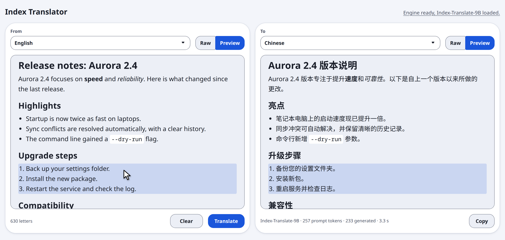

<p align="center">
  
</p>

<h1 align="center">Index Translator</h1>

<p align="center">
  <b>Translate whole documents, PDFs and pictures on your own GPU.<br>Nothing leaves your machine.</b>
</p>

<p align="center">
  <a href="https://github.com/ruihe774/index-translator/actions/workflows/ci.yml"></a>
  <a href="https://codecov.io/gh/ruihe774/index-translator"></a>
  <a href="LICENSE"></a>
  
  
  
</p>

<p align="center">
  <a href="#install">Install</a> ·
  <a href="#using-it">Using it</a> ·
  <a href="#listen-to-a-text">Read aloud</a> ·
  <a href="#settings">Settings</a> ·
  <a href="docs/openapi.yaml">API</a> ·
  <a href="THIRD_PARTY_NOTICES.md">Licenses</a>
</p>

<p align="center">
  
  <br>
  <sub>One click on a PDF page thumbnail turns the page into Markdown, translated here from English to Chinese.
  Headings and tables survive and are shown formatted on both sides; the paragraph under the pointer is highlighted in both,
  and a click scrolls the other side to it. Page 110 of
  <a href="https://ntrs.nasa.gov/citations/20140003548">NASA/TM-2014-217388</a>, a US government work in the public domain.</sub>
</p>

---

## Why Index Translator

It is a local translator for people who cannot, or would rather not, paste their documents into an online
service. It runs the Index-Translate 9B models on your GPU, with no accounts, quotas or fees.

| | |
|---|---|
| 🔒 **Private and offline** | Models run on your GPU. Your text never leaves your machine, so confidential documents are fine. |
| 📄 **Built for whole documents** | A long-document model translates a full text in one pass (Chinese ↔ English, Chinese ↔ Japanese). The app picks it for you by length. |
| 🖼️ **Reads pictures** | Drop a screenshot or photo (JPEG, PNG, WebP); the model reads and translates the text in it. No separate OCR step. |
| 📑 **Opens PDFs locally** | Text, Markdown, PDF and Word files are read in your browser. One click on a page thumbnail turns it into Markdown. |
| 🔊 **Reads aloud** | Hear the source or the translation, from any paragraph, in Chinese, English, Japanese, Spanish or Arabic, with voices and speed (IndexTTS-2.5, also local). |
| 📚 **Terminology and style** | Glossary, hard rules ("keep placeholders unchanged"), soft style guidance and a genre such as academic paper or subtitles. |
| ✅ **Tells you what went missing** | Models can silently drop or repeat paragraphs. The app counts paragraphs and warns you; when they match, click one side to jump to the same paragraph on the other. |
| ✍️ **Markdown stays Markdown** | Headings, lists, tables and code are shown formatted as they stream in, with Raw / Preview per side. Copy returns the Markdown. |

Also: streaming with **Stop**, correct Chinese and Japanese typography, an interface checked against WCAG 2.2 AA
(keyboard and screen readers), and a local REST API with streaming ([`docs/openapi.yaml`](docs/openapi.yaml)) so
other programs can use the same translator.

## Install

**You need** a GPU with a working Vulkan driver (tested on an AMD Radeon RX 9070, 16 GiB) and about 18 GiB of disk
for the models. Without a usable GPU, set `GPU_LAYERS=0` to run on the CPU, which is much slower. If something is
missing (no Vulkan driver, no models yet), the app says what and how to fix it, then stops.

Pick one:

| Your system | Use |
|---|---|
| Linux (x86-64 or aarch64) | [AppImage](#linux-appimage) |
| Windows 10 / 11 (64-bit) | [Installer](#windows-installer) |
| Anything else, or you want to hack on it | [Build from source](#build-from-source) |

### Linux AppImage

`Index_Translator-x86_64.AppImage` and `Index_Translator-aarch64.AppImage` are built for every
change: on GitHub, open **Actions**, the latest **CI** run, and download the one for your
processor under **Artifacts** (GitHub hands it out as a zip file; unpack it). The commands below
use the x86-64 name. Then:

```bash
chmod +x Index_Translator-x86_64.AppImage
./Index_Translator-x86_64.AppImage fetch   # once: the models and example voices, about 17.9 GiB
./Index_Translator-x86_64.AppImage         # start; the app opens in your browser
```

Stop the app with `Ctrl+C`. `./Index_Translator-x86_64.AppImage --help` lists the options.

- `fetch` puts the models into `~/.local/share/index-translator` and needs `curl`. An interrupted
  download continues when you run it again. To leave out reading aloud (3.7 GiB):
  `fetch --model index-translate-9b --model index-nailong-9b`. Before it downloads, `fetch` shows each
  model's license and waits for you to type `yes`; the speech model is under bilibili's own license
  with usage conditions, not Apache or MIT. `notices` prints the licenses of the software in the
  AppImage; they are also in [THIRD_PARTY_NOTICES.md](THIRD_PARTY_NOTICES.md).
- It runs on x86-64 or aarch64 Linux as new as Ubuntu 24.04 or newer (Debian 13, Fedora 40 and later). Besides
  the Vulkan driver it uses the system's `libgomp` (installed on most systems). Reading aloud needs
  an x86-64 processor with AVX2.

### Windows installer

`Index_Translator-Setup-x86_64.exe` is built for every change: on GitHub, open **Actions**, the
latest **CI** run, and download it under **Artifacts** (GitHub hands it out as a zip file; unpack
it). It needs 64-bit Windows 10 or 11. Then:

1. Run the installer. It installs for your user only (into `%LOCALAPPDATA%\Programs\Index Translator`
   unless you choose another folder) and needs no administrator rights. The installer is not
   signed, so Windows SmartScreen may warn you: choose **More info**, then **Run anyway**.
2. Start **Index Translator** from the Start menu (or let the installer start it). A small window
   with four links opens.
3. Once, click **Download models**: it fetches the models and example voices (about 17.9 GiB) in a
   console window, shows each model's license and waits for you to type `yes`. **Do not close the
   console window until it says it is done**: closing it stops the download (running it again
   continues where it stopped).
4. Click **Start translator**. The app opens in your browser; the port (3000) can be changed in the
   window first. **Do not close the console window that opens: the app runs in it, and closing it
   stops the app** (the page in your browser then stops working). Leave it open, or minimize it,
   for as long as you use the translator. To stop the app, press `Ctrl+C` in that window or close it.

**Third-party notices** shows the licenses of the bundled software (also in
[THIRD_PARTY_NOTICES.md](THIRD_PARTY_NOTICES.md)); **Server settings** lists every option. For options
the window does not offer, open Command Prompt in the install folder and start the server there,
for example `bun src\server.ts --port 8080`.

The models are downloaded into the `models` folder and the voices into the `voices` folder inside
the install folder. Uninstalling (Windows **Settings**, **Apps**) leaves them in place, so delete
the folder by hand if you want the space back. Downloading needs `curl`, which Windows 10 and later
include. Reading aloud needs a processor with AVX2.

### Build from source

```bash
bun src/server.ts
```

Then open **http://127.0.0.1:3000/** in your browser. Stop the app with `Ctrl+C`.

Before the first start, build the engines and get the models once (about 17.9 GiB):

```bash
bun scripts/build_llama.ts      # translation engine (llama.cpp, Vulkan): built from source, 1 to 2 minutes
bun scripts/build_audiocpp.ts   # speech engine (audio.cpp, Vulkan): built from source, 1 to 2 minutes
bun scripts/build_soxr.ts       # libsoxr, the resampler the speech engine uses: built from source, seconds
bun scripts/fetch_models.ts     # the two translation models, the speech and voice separation models, example voices
bun scripts/fetch_web_libs.ts   # the libraries that open PDF and Word files and compress speech in the browser (13 MB), into public/vendor/
bun scripts/fetch_turndown.ts   # turndown, which turns a fetched web page into Markdown (27 KB), into vendor/
```

Opening PDF and Word files is optional too: without `fetch_web_libs.ts` the app runs, opens text and
Markdown files, and says that PDF and Word support is not installed. Reading aloud then sends its audio
as QOA or WAV instead of the smaller Opus (`bun scripts/fetch_minicelt.ts` installs the Opus encoder; it needs
the libsoxr that `build_soxr.ts` builds). Translating a web page by its address needs `fetch_turndown.ts`
and is off until you allow some sites (see Translate a web page, below).

Reading aloud is optional. To leave it out, skip `build_audiocpp.ts` and `build_soxr.ts` and download only the
translation models with `bun scripts/fetch_models.ts --model index-translate-9b --model index-nailong-9b`.

You need [Bun](https://bun.sh) and `curl`, and to build the engines git, CMake, a C and C++
compiler, `glslc` and the Vulkan headers. On Debian and Ubuntu:
`sudo apt install build-essential git cmake ninja-build glslc libvulkan-dev spirv-headers`.
The translation engine then runs on any x86-64 processor, the speech engine on those with AVX2.

On Windows the same three commands work in Command Prompt or PowerShell. Instead of the packages
above you need Git, CMake (on the `PATH`), Visual Studio 2022 or its Build Tools with the "Desktop
development with C++" workload, and the [Vulkan SDK](https://vulkan.lunarg.com/sdk/home) (for
`glslc`); `curl` comes with Windows. Open a new terminal after installing them, so it sees the new
`PATH`. More in [WINDOWS.md](WINDOWS.md).

`bun scripts/build_appimage.ts` packs what you have built and fetched (the models excepted) into an AppImage of your own, and on
Windows `bun scripts/build_installer.ts` into an installer (it downloads Inno Setup if it is not
installed), both in `dist/`.

> [!NOTE]
> Reading aloud is optional. Skipping it saves 14.2 GiB of downloads and about 5.7 GiB of VRAM.

## Using it

Open the app in your browser (the AppImage and installer do it for you; from source it is
http://127.0.0.1:3000/). Pick languages, paste text, click **Translate**.


<details>
<summary><b>Translate text</b>: languages, Markdown, copy</summary>


1. Choose the **From** and **To** languages. Pick **Detect** if you are not sure of the
   source. Languages include English, Chinese, Japanese, Korean, German, French, Spanish, Russian
   and about 25 more.
2. Paste or type your text into the box, or click **Open** to take it from a file (see
   Open a file, below).
3. Click **Translate**. The translation appears as it is generated. Click **Stop** to end it early,
   and **Copy translation** to copy the result. **Clear** empties both sides for a new text.

Translation starts only when you click **Translate**; it does not run while you type.

If the text you enter is written in Markdown (headings, lists, code blocks, tables, links and so
on), the translation is shown formatted, as it arrives, and after you click **Translate** your text
is shown formatted too. Each side has **Raw** and **Preview** buttons to switch between the
Markdown source and the formatted view; **Raw** on your side brings back the text box for editing.
**Copy translation** still copies the Markdown source. Links open in a new tab; images are shown as
links and are not loaded.

</details>

<details>
<summary><b>Open a file</b>: text, Markdown, PDF, Word</summary>


**Open**, next to the **From** language, takes the text from a file on your computer; dropping or pasting a
file anywhere on the page does the same. A text, PDF or Word file is read by your browser and stays
there: nothing is uploaded, and the server only receives the text you then send with
**Translate**. An image is different: it is what gets translated, so **Translate** sends the image
itself to the server (see Translate an image, below). Opening a file replaces what
is in the box and removes the translation of the old text; it never starts a translation.

- **Plain text and Markdown** (`.txt`, `.md`, `.markdown`, UTF-8, up to 2 MB) go into the box as
  they are. A text written in Markdown is shown formatted right away; **Raw** brings back the text
  box if you want to edit it.
- **PDF** (`.pdf`, up to 256 MB): the pages appear as small pictures beside the box. Click a page
  to take its text, as Markdown (headings, lists, tables and emphasis are kept where the PDF
  allows); it is shown formatted, with **Raw** for editing. Click another page to replace it. One
  page at a time is taken, so a long document is translated page by page. While a PDF is open,
  **Open** reads **Close**: close the PDF before you open another file. The text you took stays.
- **Word** (`.docx`, up to 64 MB): the whole document goes into the box as Markdown (headings,
  lists, tables and emphasis are kept) and is shown formatted, with **Raw** for editing. A picture
  is not taken, only its name, as a Markdown image (shown as a link). Older `.doc` files and
  password-protected documents are not opened.
- **Images** (`.jpg`, `.jpeg`, `.png`, `.webp`, up to 8 MB): the picture takes the place of the
  text box. See Translate an image, below.

What to expect from a PDF: the text comes from the PDF's text layer. A scanned page has none, and
the app says so instead of filling the box (it does no character recognition). Where the PDF does
not say which characters its fonts stand for, which some Chinese and Japanese PDFs with fonts that
are not embedded do, the text comes out garbled and the app warns under the box. Pages in two
columns can come out in a different reading order than on paper, so look the text over before you
translate. Password-protected PDFs are not opened. Use a current browser: with a 17 MB paper, a
year-old Chromium (141) ran out of memory and closed the tab, while Chrome 156 and Firefox 157
opened it. **Open** and the page pictures have not been through the accessibility review yet.

</details>

<details>
<summary><b>Translate an image</b></summary>


Open, drop or paste (Ctrl+V) a JPEG, PNG or WebP image (a screenshot, a photo of a sign or a menu, a diagram) and
it is shown where the text box was. Choose the **To** language and click **Translate**: the image
is sent to the server on your machine, and Index-Translate-9B reads the text in it and writes the
translation. **From** can stay on **Detect language**; choosing the language helps when the picture
mixes several. **Clear** removes the picture and brings the text box back.

- Images are always translated by Index-Translate-9B, whatever model is chosen; the long-document
  model does not read images. A glossary and constraints apply as for text; the genre is not used.
- The translation is plain text in the order the model reads the picture. There is nothing to
  compare it with, so the paragraph check and click-to-scroll do not apply, and the picture is not
  kept in the History.
- An image may be up to 8 MB and 50 million pixels. Large pictures are scaled down to about
  4 million pixels for the model, so very small print in a big photo can be lost: crop to the part
  you need. A full-size picture takes a few seconds to read before the translation starts and
  uses about 4,100 tokens of the input limit.
- The first image loads the model's image encoder (0.6 GiB, part of `fetch`), which then uses
  about 1 GiB more GPU memory until the model is switched; together with reading aloud that
  fills a 16 GiB card. If the server says that images cannot be
  translated, the encoder file is missing: run `fetch` again (see [Install](#install)).
- A transparent background is treated as white.

</details>

<details>
<summary><b>Translate a web page</b>: paste its address</summary>


Paste the address of a page into the box, alone (`https://example.com/post`, or just
`example.com/post`), and click **Translate**. The app asks first: **Fetch page** has the server open
the page and put its text into the box as Markdown, shown formatted (**Raw** brings back the text box);
**Translate as text** translates the address itself; **Cancel** does neither. Look the text over, then
click **Translate** again to translate it. **Stop** ends a fetch that takes long.

The server opens the page in a browser without a window, as a visitor who is not signed in: scripts
run, nothing you are signed in to is seen. When the page marks out its main content (an article, or
the page's main part), only that is taken; menus, sidebars, the page's header and footer, forms and
whatever the page hides are left out. Links keep their full addresses.

This is the one feature that makes the server go on the internet, so it is off until you list the
sites it may open in `ALLOWED_WEBPAGE_DOMAINS` (see Settings): for example
`ALLOWED_WEBPAGE_DOMAINS=en.wikipedia.org,*.example.com`, or `*` for any site. A page on another site,
or one that sends the browser to another site, is refused. The server needs a browser to open pages
with: Chrome, Chromium, Edge or Brave installed (set `BUN_CHROME_PATH` to its program if it is
somewhere unusual; on macOS the system's WebKit is used). Only the address goes to the server; the
page's text comes back to your browser and is translated like any other text.

</details>

<details>
<summary><b>Choosing a model</b></summary>


Leave the model on **Automatic** (it picks by text length) unless you have a reason to pick one yourself.
The app then chooses:

- **Index-Translate-9B** for short texts (up to about 11,000 letters) and any language.
- **Index-NativeLong-9B** for longer texts, when the direction is Chinese ↔ English or
  Chinese ↔ Japanese. This model translates a whole document in one pass, but it only handles those
  four directions and does not support glossaries or constraints.
- **Index-Translate-9B** for longer texts in other directions, with a warning that it may drop or
  repeat paragraphs.

</details>

<details>
<summary><b>Glossary and constraints</b></summary>


Open **Glossary and constraints** to refine a translation. This works with Index-Translate-9B only.

- **Glossary:** one term per line, as `source term = target term`, for example `模型 = model`.
- **Hard constraints:** rules that must be kept, one per line, for example "keep placeholders
  unchanged".
- **Soft constraints:** style guidance, one per line, for example "formal tone".
- **Genre:** the kind of text, for example `学术论文` (academic paper) or `字幕` (subtitles). It is
  used only together with a glossary or constraints.

In **Automatic** mode, entering any of these makes the app use Index-Translate-9B. If you pick
Index-NativeLong-9B by hand while they are filled in, the app warns that the request cannot be
translated with that model.

</details>

<details>
<summary><b>History</b></summary>


The **History** panel under **Model and options** lists your last 50 finished translations, newest
first, with the time, languages and model. **Restore** puts the text, the languages and the
translation back on the page without translating again; **Delete** removes one entry and **Clear
history** all of them. The history lives in your browser's local storage only: the server never
receives or stores it, and it is not shared between browsers. Clearing the site's data in the
browser clears it too.

</details>

## Listen to a text


Each side has a **Read aloud** button (the loudspeaker) under its text. Click it and a ▶ button
appears beside every paragraph, heading and list of that side; click the one where you want to
start, the first one to hear everything. While it reads, **Previous**, **Pause** and **Next** appear
next to Read aloud, and another ▶ jumps straight to its paragraph. Click Read aloud again to stop
and hide the ▶ buttons. The paragraph being read is highlighted, and so is its ▶. With the
keyboard: Read aloud puts you on the ▶ buttons, the arrow keys move between them, and Enter starts.

The source text is read from its **Preview**, not from the text box you type in: switch to Preview
first (the button tells you so). Clicking a paragraph itself still scrolls the other side to it.

- **Languages:** Chinese, English, Japanese, Spanish and Arabic. For other languages the button
  is switched off. For the source text, choose its language under **From** if the app cannot tell
  it by itself.
- **Voice and speed:** choose them under **Model and options**. Speed goes from 0.5× to 2×. A
  change while listening takes effect from the sentence being read, which starts again.
- **Voices:** the speech model imitates the speaker of a short recording. Every `.wav` file in the
  `voices` folder (AppImage: `~/.local/share/index-translator/voices`; Windows installer: the `voices`
  folder inside the install folder) is a voice; the
  download puts the example voices of the IndexTTS demo there. To add your own, put a clean
  recording of a few seconds of speech (one speaker, no music) into the folder and reload the
  page. Only use voices of people who agreed to it.
- **Your own voice sample:** under **Model and options** you can also record or upload a sample.
  It is kept until the app stops. Only the first 15 seconds are used: a recording stops there and a
  longer file is cut. The voice is first taken out of any music and background noise
  by a separation model (BS-RoFormer), which takes a few seconds; the speech model leaves the GPU
  while that runs and is loaded again by the next sentence, which takes about five seconds. Without
  the separation model (`fetch --model bs-roformer`, 0.2 GiB) the sample is used as it is, so a
  clean recording matters then.
- **Markdown:** a text that is shown formatted is read the way it is shown. Headings, list items
  and table rows are read one by one, numbered lists with their numbers, table cells with their
  column heading, links by their text and images by their description. Code blocks are skipped.

The first sentence takes about five seconds longer, because the speech model is loaded when you
first listen. It needs about 5.7 GiB of GPU memory beside the translation model and is unloaded
again after five minutes without listening. Speech is generated sentence by sentence, about four
times faster than it is spoken, so long texts start right away. While you listen, the sentences
that follow are generated in the background (up to a minute and a half ahead), and what you have
heard is kept, so **Previous** and **Next** usually start at once (a far ▶ waits for its first
sentence).

Known limits: numbers written in digits are read correctly in Chinese, English, Spanish and
Japanese, but not reliably in Arabic, and unusual formats (for example `$1,200`) may be read
oddly in any language.

## Check long translations


Language models can occasionally drop or repeat paragraphs, and this is not reported as an error.
After each translation, the app compares the number of paragraphs with the source. If they differ,
it shows a warning. When you see one:

- compare the translation with the original, paragraph by paragraph;
- for a long text, try the other model, or split the text into sections and translate each one.

When the counts match, you can click a paragraph on either side to scroll the other side to the
same paragraph. This stops once you edit your text.

The model you use also matters. In testing, Index-NativeLong-9B translated a 30-paragraph English
document to Chinese completely, but Chinese-to-English translation of a full-length document was
not reliable, so check those results carefully.

## Settings


Optional settings are environment variables set before the app starts, or command-line flags
(the lowercase name with dashes: `PORT` is `--port`, `DEFAULT_MODEL` is `--default-model`). A flag
overrides the environment variable:

```bash
PORT=8080 bun src/server.ts
bun src/server.ts --port 8080
./Index_Translator-x86_64.AppImage --port 8080
```

In Windows Command Prompt, set a variable with `set PORT=8080` (it lasts until the window is
closed); flags work as above.

| Variable | Default | What it does |
|---|---|---|
| `PORT` | `3000` | Port the app listens on |
| `HOST` | `127.0.0.1` | Address to listen on. The app has no login, so keep it on `127.0.0.1` unless you put it behind a proxy. |
| `DEFAULT_MODEL` | `index-translate-9b` | Model loaded at startup |
| `GPU_LAYERS` | `all` | Layers to run on the GPU; `0` runs on the CPU |
| `LLAMA_THREADS` | half the CPU threads | CPU threads for the engine; matters when running on the CPU |
| `MAX_QUEUE` | `8` | Requests that may wait while another is running. Beyond this, the app reports that the translator is busy. |
| `SPEECH` | on | `0` turns reading aloud off |
| `ALLOWED_WEBPAGE_DOMAINS` | none (off) | Sites whose pages the app may fetch for translation, comma separated: `example.com`, `*.example.com` (its subdomains) or `*` (any site) |
| `MODELS_DIR` | `models/`; AppImage: `~/.local/share/index-translator/models`; Windows installer: `models\` in the install folder | Folder with the models; `fetch` downloads into it |
| `VOICES_DIR` | `voices/`; AppImage: `~/.local/share/index-translator/voices`; Windows installer: `voices\` in the install folder | Folder with the voice recordings (`.wav`) |
| `SPEECH_IDLE_UNLOAD` | `300` | Seconds without listening after which the speech model leaves the GPU; `0` keeps it loaded |

Only one translation runs at a time. Other requests wait in line.

## Contributing

Building, testing and the project's conventions are in [CLAUDE.md](CLAUDE.md) (commands, layout, invariants),
[WINDOWS.md](WINDOWS.md) and [A11Y-ACCEPTANCE.md](A11Y-ACCEPTANCE.md). Run `bun test` before sending a change.

## License

Index Translator is released into the public domain under [The Unlicense](LICENSE). The software and models it
uses keep their own licenses; see [THIRD_PARTY_NOTICES.md](THIRD_PARTY_NOTICES.md).
